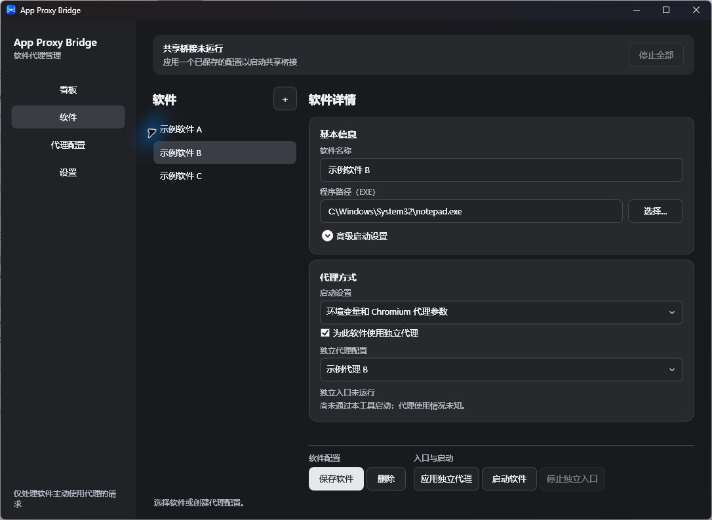

# App Proxy Bridge

Windows 桌面代理管理工具的开发预览。通过本地 HTTP 桥接和目标软件支持的启动参数或环境变量，连接用户提供的 HTTP、HTTPS 或 SOCKS5 上游代理。

**当前为 0.9.0 开发预览，不是正式发布版。** 已验证模拟代理和隔离测试程序，尚未在真实 Claude Code、Hermes、Grok Bot 或 Discord 上完成验收；不能保证软件的全部流量经代理。没有使用或安装驱动。



## 基本使用

1. 默认首页是看板，展示软件、本地入口与代理配置。选择节点可以查看详情并跳转到对应页面。
2. 在“代理配置”中新增并保存配置；“测试连接”针对当前输入，应用共享代理前会再次测试。
3. 在“软件”中添加 EXE，选择它支持的启动方式。默认使用共享代理；需要不同上游时，勾选“为此软件使用独立代理”并选择配置。
4. 在配置页应用共享代理，或在软件页应用独立代理，然后启动目标软件。目标软件必须主动遵循相应环境变量或启动参数。
5. 切换代理仅影响新连接；已有连接保留原上游。切换共享/独立入口或更改端口时，目标软件通常需要重新启动。本工具不会强制关闭目标软件。

看板每两秒更新。虚线代表已保存的配置关系，实线代表入口实际生效的上游；入口连接数包含正在建立的连接。共享端口的连接不能可靠归属到某个软件，软件运行也不代表其全部流量已经通过代理。最近错误只保留在本次运行的内存中，重启后清除；不记录密码或目标地址。

关闭窗口收至托盘；通过托盘可打开窗口、停止所有桥接或退出。停止桥接会断开使用对应入口的连接；目标软件之后是否直连取决于它自身，程序不承诺防直连。

共享入口默认监听 `127.0.0.1:7996`，独立入口首次启用时自动分配端口并保存。所有监听仅绑定本机回环地址，但其他本机程序仍可能连接这些端口。端口被占用时显示错误，不接管已有程序。

目标程序当前只接受 EXE 完整路径；不自动识别或保证 MSIX 激活、`.cmd` 包装器、后台服务、已有实例、远程环境、UDP、云端 Agent、浏览器其他实例或应用自行忽略代理设置的流量。Chromium 启动模式是通用参数方案，具体软件仍须实测。

## 数据与安全

个人数据独立保存在 `%LOCALAPPDATA%\AppProxyBridge.Next`，不读取或覆盖旧版数据。密码使用当前 Windows 用户 DPAPI 加密，普通配置和进程启动参数不包含上游密码。HTTP 上游认证不会为上游链路提供加密；HTTPS 上游保留证书验证。

程序不修改 Windows 系统代理、DNS 或默认路由，不是 VPN，也不保证强制代理或网络隔离。文档、截图与测试使用模拟数据，不应公开真实代理地址、账号或密码。

## 运行与开发

从 [GitHub Releases](https://github.com/Leon0555/App-Proxy-Bridge/releases) 下载 Windows x64 自包含预览包，解压后运行 `App Proxy Bridge.exe`，无需另外安装 .NET 运行时。请保留解压目录中的配套文件。若旧版预览仍在运行，请先从其托盘菜单正常退出。新旧项目使用不同的数据目录，新版本不会自动导入旧配置。此构建尚未在干净电脑上验证，未进行代码签名。

需要 .NET 10 SDK 构建：

```powershell
dotnet build src/AppProxyBridge.App -c Release
dotnet run --project tests/AppProxyBridge.Core.Tests -c Release
dotnet run --project tests/AppProxyBridge.UiTests -c Release
./build.ps1
```

核心测试使用本机模拟代理和临时配置；WPF 检查使用临时配置生成模拟界面截图。测试不应读取用户的代理配置或启动真实目标程序。开发及验证记录见 [docs/设计与实施记录.md](docs/设计与实施记录.md)。

## 许可证

本项目及复用的 GPT Proxy Bridge、原 App Proxy Bridge 代码按 [MIT License](LICENSE) 分发，具体来源见 [THIRD-PARTY-NOTICES.md](THIRD-PARTY-NOTICES.md)。

